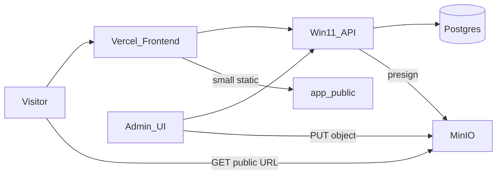

# MinIO Media Infrastructure (Phase 1) — Design

Date: 2026-07-17  
Status: Approved  
Related plan: `docs/superpowers/plans/2026-07-17-minio-media-phase1.md`  
Cursor plan: `.cursor/plans/media_minio_phase1_fa5e204a.plan.md`

## Goal

Stop hardcoding large media into the Vite frontend. Place assets by responsibility:

| Layer | Responsibility |
|-------|----------------|
| **DB** | Structured content and media metadata (`media_assets.public_url`, title, alt, tags, slugs, status). Marketing/itinerary content moves in later phases. |
| **MinIO (S3)** | Large images, videos, PDFs (including former `本站/` assets). |
| **`app/public`** | Tiny, rarely changed static files only (favicon, default logo). |

Phase 1 delivers object-storage infrastructure and removes broken local Vite imports. It does **not** migrate Home/About/guides/itineraries into the DB.

## Topology

- **Vercel**: public frontend.
- **Windows 11 server**: content API + Postgres + MinIO (S3-compatible). Same MinIO API for local development and production.
- Visitors load media from MinIO public URLs; Admin uploads via API-issued presigned PUT (secrets never ship to Vercel).

## Object storage contract

- **Bucket**: `xtch-public` (Compose bootstrap; anonymous download / public-read).
- **Object key** (new uploads): `{env}/{type}/{yyyy}/{mm}/{uuid}-{safeFilename}`
  - `env`: from `APP_ENV` or derived from `NODE_ENV` (`dev` / `prod`).
  - `type`: derived from content type (`image` | `video` | `pdf` | `file`).
  - Replaces current `media/{stamp}-{rand}-{safeFilename}` for **new** objects only.
  - Existing objects under `media/...` are left as-is; no migration in Phase 1.
- **Public URL**: `{S3_PUBLIC_BASE_URL}/{objectKey}` (path-style MinIO).
- **Env on Win11 API**: `S3_ENDPOINT`, `S3_ACCESS_KEY_ID`, `S3_SECRET_ACCESS_KEY`, `S3_BUCKET`, `S3_PUBLIC_BASE_URL`, `S3_REGION`.

## Upload flow

1. Admin authenticates → `POST /api/admin/media-presign` with `filename` + `contentType`.
2. API validates allow-list → builds key → returns `uploadUrl` + `publicUrl`.
3. Browser PUTs file directly to MinIO.
4. Admin `POST /api/admin/media` (`action: create|update`) stores metadata including `publicUrl` in `media_assets`.
5. URL-paste remains supported for external hosted assets.

Allowed content types: JPEG, PNG, WebP, GIF, SVG, MP4, WebM, PDF.

## Frontend / Admin behavior

- **Admin**: file picker upload (presign → PUT → register) plus existing URL paste; clear errors if S3 is unconfigured or PUT fails.
- **Site**: no Vite imports from `本站/`. Brand logo and About images are URL strings.
  - Interim: `/images/...` under `app/public` is acceptable.
  - After ops upload: replace with MinIO `publicUrl` (same PR or short follow-up).
- Marketing copy and itinerary text stay in TypeScript for Phase 1.

## Existing code to reuse / adjust

Already present (keep, align to this spec):

- `docker-compose.yml` — Postgres + MinIO + `xtch-public` init
- `app/api/lib/s3.ts` — S3 client + presign (**change `buildObjectKey`**)
- `app/api/admin/media-presign.ts`, `app/api/admin/media.ts`
- `app/src/lib/mediaClient.ts`, Admin media UI upload path
- `siteData.ts` / `About.tsx` — already on URL strings (interim public paths)

Primary remaining code change: implement the agreed key format in `buildObjectKey`, verify end-to-end on Win11, document `S3_*` setup.

## Success criteria

1. Vite does not fail on `本站` import-analysis.
2. Admin can upload an image to MinIO; the public URL opens; new keys match `{env}/{type}/{yyyy}/{mm}/...`.
3. Navbar/Footer/About media load from URL strings, not Vite file imports.
4. MinIO secrets exist only on the Win11 API process.
5. Compose brings up MinIO + `xtch-public`; `S3_*` is documented for operators.

## Out of scope (Phase 1)

- DB migration of Home/About/guides/itineraries
- Full marketing CMS
- Changing Vercel hosting model
- Git-tracking `本站/` or large route corpora
- Migrating existing `media/...` object keys

## Phase 2+ (direction only)

- Move remaining marketing and itinerary content into DB + Admin.
- Optionally point brand/About image fields at `media_assets` instead of TS constants.
- Harden Win11 exposure (HTTPS reverse proxy, backups) as traffic grows.
