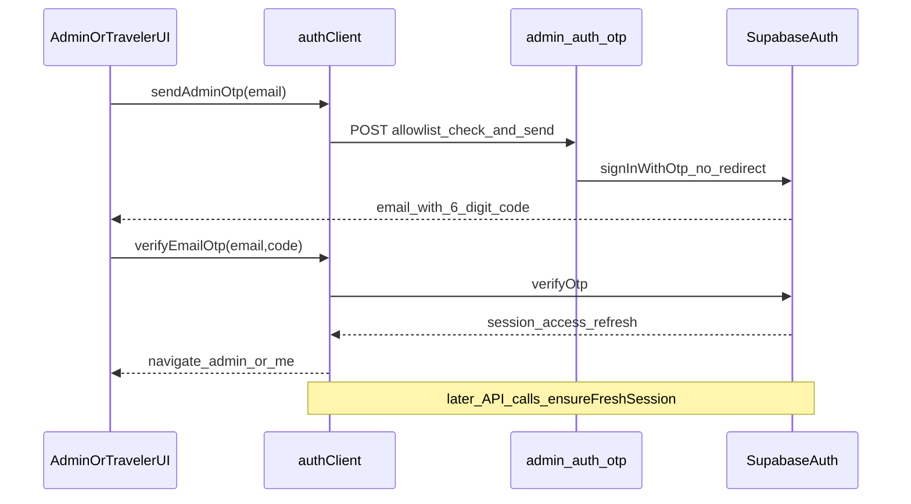

# Auth Session + Email OTP (P0) — Design

Date: 2026-07-18  
Status: Approved  
Related plan: `docs/superpowers/plans/2026-07-18-auth-session-otp-p0.md`  
Cursor plan: `.cursor/plans/auth_session_otp_p0_dcd4f934.plan.md`

## Goal

Same-device users stay signed in via refresh-token renewal (Notion/Slack-style). Email sign-in uses a 6-digit OTP on the same page. Admin emails not on the allowlist never trigger a send. Magic link is no longer the primary CTA.

## Locked decisions

| Topic | Decision |
|-------|----------|
| Vendor | Keep Supabase Auth |
| Session | `@supabase/supabase-js` with `persistSession` + `autoRefreshToken` |
| Facade | `authClient.ts` still exposes `AuthSession` / `accessToken` to Account, China Trips, Admin |
| Admin send | Server allowlist gate → Supabase `/auth/v1/otp` **without** `email_redirect_to` |
| Traveler send | Client `signInWithOtp` (`shouldCreateUser` matches current allow-register behavior) |
| Verify | Client `supabase.auth.verifyOtp({ type: 'email' })` |
| Migration | One-time: if old `syncing_travel_auth_session` has refresh, `setSession` then delete old key (no dual-write) |
| Ops | Supabase Magic Link email template must use `{{ .Token }}` (Dev + Prod); not changed in code |
| Out of scope (P1+) | Microsoft/Azure, password, Passkey, Clerk, httpOnly BFF, custom SMTP, disable Confirm email |

## Architecture

- **Truth source:** Supabase JS session storage.
- **Facade:** `readStoredAuthSession`, `ensureFreshSession`, OTP/OAuth helpers; bypass email still short-circuits for local Admin.
- **OAuth (Google/Apple):** Unchanged redirect flow; `AuthCallback` + residual `#access_token` consumption remain as safety nets.
- **401:** `fetchMyOrders` / Admin `me` retry once after `ensureFreshSession`.

## UX

### Admin Sign In

1. Google (unchanged) or email.
2. Email → Send code → enter 6 digits → verify on same page.
3. 60s resend countdown; rate-limit friendly copy.
4. No primary “Send magic link” CTA.

### Traveler (China Trips)

1. Google → Email OTP two-step → Apple.
2. Same-page verify; success returns to pending path / Me focus as today.
3. Guest checkout remains unblocked.

## Ops checklist

1. Supabase Dashboard → Auth → Email templates → Magic Link body includes `{{ .Token }}` (and preferably the code as the main instruction).
2. Redirect URLs still needed for OAuth (and any residual link clicks).
3. Acceptance: same-device refresh stays signed in; OTP works; resend countdown; guest order not gated.

## Success criteria

- [ ] Admin allowlisted email receives 6-digit code; non-allowlist gets 403 and no send.
- [ ] Traveler can complete email OTP without leaving the Mini-App page.
- [ ] After sign-in, refresh does not force re-login while refresh token is valid.
- [ ] Old `syncing_travel_auth_session` is migrated once and removed.
- [ ] `npm run build` + `npm run lint` pass in `app/`.
