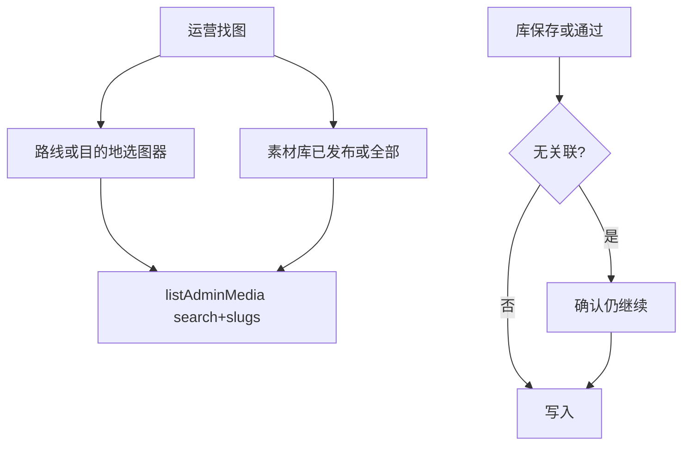

# 运营找素材：选图器 + 素材库 + 关联提醒

Date: 2026-07-28  
Status: Approved（用户确认实施）  
Related: Admin 素材审库体验、视频 cover_url

## 定案（已锁定）

| # | 决策 |
|---|------|
| 1 | 范围 = A 选图器 + B 素材库逛库 + C 关联/命名习惯 |
| 2 | 落地顺序 = 先 C（轻）→ A → B（可同一 PR） |
| 3 | 关联 = **强提醒可跳过**；选图器带上下文上传仍自动带关联 |
| 4 | 选图器 = 标题/标签搜 +「仅本条关联」+ 目的地/路线下拉；不做类型筛 |
| 5 | 素材库各状态页签 = 与选图器同套筛（目的地、路线、标题/标签） |
| 6 | 标题 = **软提示**「建议地点+主题」，不拦保存 |
| 7 | **不做**：选图器视频类型、硬门槛关联、坏名硬拦截、批量回填历史关联 |

## 1. API：搜索含 tags

文件：`app/api/lib/contentQueries.ts` — `listAdminMedia`

在现有 `search` 条件上增加 tags 匹配，例如：

```sql
OR EXISTS (
  SELECT 1 FROM unnest(tags) AS tag
  WHERE tag ILIKE '%' || ${search} || '%'
)
```

`app/src/lib/mediaClient.ts` 的 `fetchAdminMedia` 已支持 `search` / `routeSlug` / `destinationSlug`，无需新端点。

## 2. C — 关联强提醒 + 标题软提示

文件：`app/src/pages/Admin.tsx` — `MediaPanel`

- **保存** / **通过并保存**前：若 `destinationSlugs` 与 `routeSlugs` 皆空 → 确认框（说明难筛选；「仍要继续」/取消回关联区）；确认后照常提交
- **列表一键通过**：同样检查；未关联则确认后再 `published`
- **标题软提示**（不拦）：空标题，或像纯文件名（长随机段、仅扩展名风格等简单启发式）→ 提示「建议改成地点+主题，方便搜索」
- 选图器直传路径不加门槛（已自动带 context slug）

## 3. A — 选图器

文件：`app/src/components/admin/ImageFieldPicker.tsx`

- 弹窗加载目的地/路线列表（`fetchAdminDestinations` / `fetchAdminRoutes`）
- 筛控件：搜索（placeholder 含标签）、目的地 select、路线 select、「仅本条关联」（有 context 时）
- **服务端筛选**：`fetchAdminMedia({ status: 'published', search, routeSlug, destinationSlug })`，再滤 `type === 'image'`；改筛即重拉
- 「仅本条关联」勾选时：用 context slug 作 route/destination 参数；禁用或清空冲突下拉
- 网格展示保持

## 4. B — 素材库列表

文件：`app/src/pages/Admin.tsx` — `MediaPanel` 列表区

- 页签下增加同构筛：搜索、目的地、路线（复用已有 destinations/routes state）
- `loadMedia` 传入 `search`、`routeSlug`、`destinationSlug`；筛变更自动加载
- 待审空状态：无待审且无搜索/关联筛 → 专用空状态；有筛无结果 →「无匹配」

可选：抽 `app/src/components/admin/MediaBrowseFilters.tsx` 供选图器与 MediaPanel 复用。

## 交互



## 验证

1. 选图器：按目的地/路线缩小列表；搜标签命中；「仅本条关联」可用
2. 素材库：同套筛在已发布/全部生效；待审默认与空状态不破坏
3. 无关联保存/通过 → 确认；确认后成功；烂标题仅提示可保存
4. 选图器直传仍自动关联当前路线/目的地
5. `cd app && npm run build && npm run lint`

## 实施待办

1. `listAdminMedia` search 增加 tags 匹配
2. MediaPanel：无关联确认框 + 标题软提示；一键通过同样检查
3. ImageFieldPicker：目的地/路线下拉 + 服务端筛 + 标签搜索
4. MediaPanel 列表：同构筛并自动加载
5. build + lint；筛选与关联提醒点验
