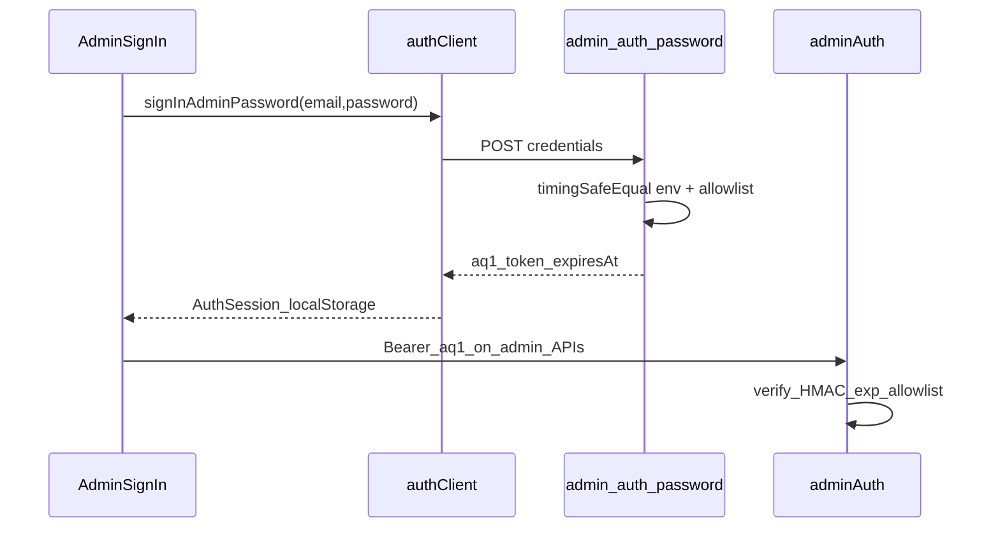

# Admin 账号密码快捷登录（env 口令）

Date: 2026-07-28  
Status: Approved（用户确认实施）  
Related: Auth Session + Email OTP P0（密码曾列为 out of scope；本设计为明确增量）

## Goal

管理端在保留 Google 与邮箱 OTP 的前提下，增加 **env 配置的单组邮箱+密码** 快捷登录，正式环境在配置后可用。不在 Supabase Dashboard 设密。

## Locked decisions

| Topic | Decision |
|-------|----------|
| 场景 | 正式环境也可用（任意 target，只要配了 env） |
| UI | Google → 邮箱+密码区 →「改用验证码登录」进现有 OTP |
| 凭据 | `ADMIN_QUICK_LOGIN_EMAIL` + `ADMIN_QUICK_LOGIN_PASSWORD`（单组） |
| 名单 | 登录邮箱必须等于 quick email，且仍在 ops/tech allowlist |
| 会话 | 服务端签发短期 Admin-only HMAC token（前缀 `aq1.`），非 Supabase session |
| TTL | 12 小时；过期需重新登录（无 refresh） |
| 签名密钥 | 由 `ADMIN_QUICK_LOGIN_PASSWORD` + 固定应用盐派生；改密即废旧 token |
| 未配置 | 不显示密码表单（前端探测启用状态） |
| 错误文案 | 模糊失败，不区分邮箱/密码/未启用 |
| 限流 | 按 IP 短窗限制 `POST /api/admin/auth-password` |
| 审计 | 成功/失败写 audit（IP hash；成功可记 email） |
| Out of scope | Supabase 密码、忘记密码、多账号 env 列表、旅客端密码、替换 Google/OTP、永久 bypass token |

## Architecture



- **Truth for quick login:** HMAC token accepted only in `requireAdminAuth` / `requireTechAdminAuth`.
- **Supabase path:** Unchanged for Google/OTP.
- **Dev bypass:** Existing `DEV_AUTH_BYPASS_EMAIL` + `dev-bypass-token` unchanged；quick login is separate and allowed on public targets when env is set.

## Env

```text
ADMIN_QUICK_LOGIN_EMAIL=ops@example.com
ADMIN_QUICK_LOGIN_PASSWORD=use-a-long-random-secret
```

- Document in `env/*/ .env.example`（注释 + 空值）；真实值不进 git。
- Ops note: production 必须强口令；轮换密码即踢掉所有 quick sessions。

## API

### `GET /api/admin/auth-password`

- Returns `{ ok: true, enabled: boolean }` where `enabled` is true only if both email and password env are non-empty.
- No secrets in response.

### `POST /api/admin/auth-password`

- Body: `{ email, password }`
- Checks: both env set; email normalized match; timing-safe password compare; `resolveAdminRole(email)` non-null
- Success: `{ ok: true, accessToken, email, expiresAt }`（expiresAt ms）
- Failure: `401` + generic error；rate-limit → `429`
- Audit: `admin_quick_login` / `admin_quick_login_failed`

### Token

- Format: `aq1.<base64url(payloadJson)>.<base64url(hmacSha256)>`
- Payload: `{ email, exp }`（exp unix seconds）
- HMAC key material: `SHA-256("xtch-admin-quick-v1|" + password)` or equivalent fixed salt + password

## Frontend

- `Admin.tsx` `SignInView`: password block when `enabled`; link to OTP step/flow
- `authClient.ts`:
  - `fetchAdminQuickLoginEnabled`
  - `signInAdminPassword` → store `AuthSession`（legacy storage key or dedicated key readable by `readStoredAuthSession`）
  - `ensureFreshSession` / `readStoredAuthSession`: if token starts with `aq1.`, skip Supabase refresh; if `expiresAt` past → clear and return null
  - `clearStoredAuthSession`: clear quick session too
- After login: existing Admin gate via `fetchAdminMe` still applies（token must pass `requireAdminAuth`）

## Wire-up

- `localApiRoutes.ts` / Vite admin API map: register GET+POST `auth-password`
- `adminAuth.ts`: branch for `aq1.` before Supabase user fetch

## Verification

1. Unset env → Admin 登录页无密码区；Google/OTP 正常
2. Set env + allowlist → 密码登录进 Admin；错误口令模糊失败
3. Email 对但密码错 / 密码对但不在名单 / 邮箱不等于 quick email → 均失败
4. Token 过期或改 env 密码后 → Admin API 401，需重登
5. Google/OTP 回归；旅客登录不变
6. `npm run build` + `npm run lint`

## Implementation todos

1. Token helper + `adminAuth` 认 `aq1.`
2. `GET/POST /api/admin/auth-password` + rate limit + audit + route map
3. `authClient` quick session read/write/fresh
4. Admin `SignInView` UI
5. env examples + gotchas 一行
6. build/lint
